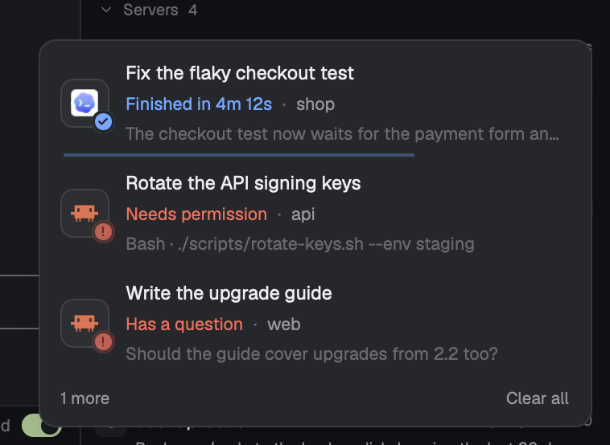

# Agent toast

A replacement for Herdr's notification toast. Herdr's own agent toasts say
"Claude Code finished · chief / 2". This one says which task finished and what happened,
and keeps the toasts in one stack that waits while you read it.

![The Herdr window with the notification stack in the bottom right corner and the rest of the window dimmed. The stack holds three toasts, the newest at the bottom, next to the corner. Fix the flaky checkout test: Finished in 4m 12s, shop, with its last words, "The checkout test now waits for the payment form an…", and a thin line under it counting down its time. Rotate the API signing keys: Needs permission, api, with "Bash · ./scripts/rotate-keys.sh --env staging". Write the upgrade guide: Has a question, web, with "Should the guide cover upgrades from 2.2 too?". The two that need you have a red badge on the Claude Code icon and no line. Under them a bar says "1 more", with Clear all. Behind, dimmed: the Sessions sidebar on the left, with the two agents that need you at the top; Claude Code speeding up the checkout page in the middle, under a header with its model, context and limits; pull requests, system stats and running servers on the right; and the status bar, ending in the VPN switch for Acme EU. The sessions are made up.](preview.png)

*Around it: the [Sessions sidebar](https://github.com/jeffarese/herdr-agents-sidebar) on the left, the pane header (local) over Claude Code, [pull requests](https://github.com/jeffarese/herdr-prs), [stats](https://github.com/jeffarese/herdr-stats-mod) and Running (local) on the right, and a VPN switch in the status bar. Every session in it is made up.*

One toast:

```
┌───────────────────────────────────────────────────────┐
│ [▣✓]  Reddit sync on Android phone                  × │
│       Finished in 4m 12s · chief                      │
│       Sync now runs on the phone every 15 minutes…    │
└───────────────────────────────────────────────────────┘
```

- **Title**: the agent's task, named the way Herdr's Agents panel names it: a tab someone
  named, else the agent's own title, else the program.
- **Icon**: the program's icon, with a badge for the news: a blue check when it finished, a
  pulsing red "!" when it needs you.
- **State**: "Finished in 4m 12s" (the turn length the agent printed), "Needs permission",
  "Has a question" or "Needs you". Then the space, a named tab, and the machine for remote agents.
- **Preview**: the agent's last words, read from the end of its screen with `hc read` after
  the toast appears. For a finished turn this is a `※ recap:` written after it, else the first
  paragraph of its last message. For a permission request it is the tool and command
  (`Bash · rm -rf …`). For a question it is the question. If nothing is found, there is no third line.
- **Click** goes to the agent. **×**, shown on hover, dismisses it without going.
- **Stale toasts close themselves**: once you look at the agent (done turns idle) or it goes
  back to work (you answered it somewhere else).

Every other `notify()` keeps a plain style: an icon for its level (a check badge, a red stop
sign, a warning triangle, an "i" speech bubble), the title, and up to two lines of body.
Herdr's machine-login toast gets a key and keeps its **Copy** button. An agent whose program
has no icon gets a robot. The six icons in `mods/agent-toast/icons/` are small 3D objects
generated with OpenAI's `gpt-image-2.6-sunburst` at 1024 px on a transparent background, then
trimmed and scaled to 136 px. The wash and the clock line of a plain toast use the icon's
color; agent toasts use the theme's.

## The stack

All toasts share one panel in the bottom right corner: a floating block in the layout, drawn
by the same mod. Each notification Herdr opens hands its news to that panel and closes.

<p align="center"></p>

- **Rows fold in and out.** A new toast opens with a wash of its color that fades. A leaving one
  folds away and the rows around it slide. An agent's last words arrive a moment after the
  toast, and the row grows a line for them.
- **A thin line under each toast runs out with its time**: 8 s for a finished turn, 6 s for
  plain news, 8 s for a warning, 10 s for an error, 15 s for the login hint. A `notify()` that
  gives its own `timeout` keeps it.
- **Nothing leaves while the pointer is on the panel.** Every clock goes back to full and
  starts again when the pointer leaves. The clocks also wait while Herdr isn't the active
  window, so news that arrived while you were elsewhere is still there when you come back.
- **An agent that needs you stays** until you answer it, look at it or dismiss it. It has no
  line.
- **Three toasts show at once.** Older ones fold under an "N more" bar, and hovering the panel
  unfolds them all. The newest toast sits next to the corner, so the rows under the pointer
  don't move when the older ones unfold. **Clear all** on that bar dismisses everything.
  Past eight, the oldest leaves.
- **News about the same agent renews its row** instead of adding one, and the same plain
  notification posted twice shows once.
- **Drag the panel** to another edge or corner. Herdr remembers the spot. Anchored at the
  top, the order flips so the newest is still next to the edge.

A layout without the floating block still works: each toast then draws itself in Herdr's own
overlay (372×77, Herdr's stacking and timeout), with the same content.

The panel is part of the layout, so it sits under dialogs: a toast that arrives while
Settings or the palette is open is dimmed until the dialog closes.

## Install

```sh
sh install.sh
```

This checks the mod with `herdr-app check` and copies it to `~/.config/herdr-app/mods/agent-toast`.
Then it changes the layout currently shown in two places: `"toast": "agent-toast"` sends every
notification to the mod, and a floating block with id `agent-toasts` is the stack:

```json
"floating": [
  { "id": "agent-toasts", "content": { "mod": "agent-toast", "props": { "role": "stack" } }, "edge": "bottom", "align": "end" }
]
```

Other personal layouts that already use the mod get the floating block too. Herdr's own
layouts are read-only, so if `main`, `terminals` or `win98` is shown, the installer clones it
as `<name>-toasts` and switches to the clone. Run it again to update the mod. To go back to
Herdr's toast, delete the `"toast"` line and the floating block from the layout, or switch
back to the shipped layout: `herdr-app do layout.switch --name main`.

## Tests

```sh
npm test
herdr-app check mods/agent-toast
```

The model tests cover kind detection, titles, location, and preview parsing on Claude Code
screens (recaps, tool-call noise, boxed and bare permission dialogs, questions). The store tests
cover the stack's rules with the clock passed in: timeouts, pausing, renewing a row, the limit.
The view tests run the real view against an in-memory GPUI builder: handing a notification to
the stack, the rendered text, folding in, click and dismiss, the clock line, folding past three,
closing when stale, the login Copy button, and the fallback to Herdr's overlay.

On 2026-11-18 the mod passed Herdr 0.1.16's native checker and ran in the live window.
Notifications posted with `notify()` (plain ones, and agent toasts aimed at running agents)
were captured with `herdr-app shot`: rows folding in, the wash, previews arriving, the clock
lines, folding under "N more", expiry, and the fallback with the floating block removed.
Hovering was not driven with a real pointer: Herdr doesn't take synthetic pointer events in the
background, so pausing and unfolding on hover are covered by the view tests only.

## Works well with

The pictures above are one Herdr window with these mods running together:

- [Sessions sidebar](https://github.com/jeffarese/herdr-agents-sidebar): every agent and shell on all your machines in one sidebar, with sub-agents and background work.
- [Pull requests](https://github.com/jeffarese/herdr-prs): your pull requests and the state of their checks, in a sidebar.
- [Stats](https://github.com/jeffarese/herdr-stats-mod): CPU, memory, GPU, network and temperatures beside your terminals, and which agent is using them.
- [Quick switcher](https://github.com/jeffarese/herdr-bar-mod): ⌘K to any agent, tab, pane or space on every machine.
- [Mod hub](https://github.com/jeffarese/herdr-mod-hub): browse the gallery, read a mod's code before installing it, and manage your mods.
- [Outside](https://github.com/jeffarese/herdr-outside): the agents and terminals herdr-core runs outside your spaces.
- [Remote open](https://github.com/jeffarese/herdr-remote-open): links, sign-ins and images opened on other machines come up on the Mac you're using.
- Running (`~/workspace/herdr/herdr-running`, local): what this computer runs: servers, processes and scheduled jobs.
- Pane header (`~/workspace/herdr/herdr-pane-head`, local): a pane header with the agent's model, effort, context and limits.
- Team (`~/workspace/herdr/team-agents`, local): your teammates' agents, read-only.
